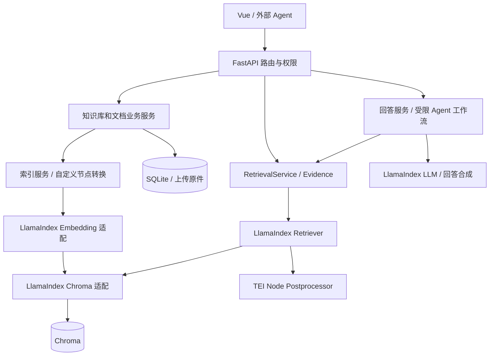

# 使用 LlamaIndex 重构 Antler RAG

> 状态：待实施方案，本文不表示相关能力已经上线。日期：2026-10-30。
> 范围：用 LlamaIndex 统一 RAG 内核，保留现有平台与业务契约。本文只规划，不修改运行代码或生产数据。

> 实施记录：[代码改动、验证与未完成发布门槛](../llamaindex-implementation.md)。原文保留为验收依据；当前不表示 P4/P5 已通过。

## 1. 决策与目标

采用 **保留平台层、替换 RAG 编排层、独立重建向量索引** 的方案。

完成后的普通检索必须经过 LlamaIndex Retriever，入库必须生成 LlamaIndex TextNode 并通过向量适配器持久化，聊天必须使用统一 LLM 适配器与回答合成流程，Agentic 使用显式的受限工作流。不能仅增加依赖或在原链路外包一层名称。

首期目标是行为兼容和职责收敛，不承诺仅更换框架就提升检索质量。混合检索、上下文扩展、飞书与企微接入作为后续独立能力实施。

保持单应用容器、单写入进程、SQLite + Chroma + 原始文件的轻量部署方式。无须购买 LlamaCloud/LlamaParse，不增加托管服务依赖。

## 2. 现状依据

| 代码 | 当前职责 | 重构决策 |
| --- | --- | --- |
| `src/app.py` | 创建数据库、向量存储、检索、Agent 与图谱服务 | 改为从统一工厂注入 RAG 运行时 |
| `src/rag/store.py` | Chroma、HTTP embedding、TEI 重排、切片读写 | 拆分模型、存储、重排适配器 |
| `src/rag/retrieval.py` | Evidence、过滤条件、Retriever 协议、去重 | 保留领域契约，引入 LlamaIndex Retriever 实现 |
| `src/rag/chunking.py` | 字符预算递归分块、结构分块、来源元数据 | 保留算法，包装为节点转换步骤 |
| `src/services/document_indexing.py` | 上传、重建、状态与失败补偿 | 继续负责业务生命周期，调用新索引接口 |
| `src/services/chat.py` | 直接调用兼容 OpenAI 的聊天接口 | 使用统一 LLM 适配器与受控回答合成 |
| `src/rag/agentic.py` | 查询规划、多次向量检索、去重与回答 | 用受限工作流表达相同步骤 |
| `src/rag/graph_build.py`、`graph_store.py` | 实体关系提取、SQLite 图谱及来源清理 | 保留图谱存储，抽取调用复用统一 LLM |
| `src/routers/*` | 权限、请求校验、API 错误与响应 | 保持外部契约，只调整依赖注入 |

路径均相对于 `apps/backend`。当前 RetrievalService 只启用向量检索；已有图谱构建不等于图谱已经参与普通检索。现有评估包含固定返回值和字符哈希 stub，适合契约回归，不能当作真实语义检索基准。

## 3. 范围

首期纳入：节点映射、embedding 与 LLM 适配、Chroma 入库和检索、TEI 后处理、回答合成、受限 Agentic 工作流、索引导出转换、回归与性能基线、运维文档。

继续保留：Vue、FastAPI、Supabase、角色和 scope、API Key、SQLite 业务表、上传原件、审计、文档状态与补偿、结构解析、图谱表和管理接口。

另立迭代：BM25/融合、父子节点检索、图谱检索接入、OCR、网页采集、飞书/企微同步、版本化局部更新、多进程部署。新框架不自动解决这些问题。

## 4. 目标架构



建议文件布局：

```text
src/rag/
  contracts.py          # Evidence、Filters、Trace、索引接口
  runtime.py            # 实例工厂、模型注入、关闭资源
  nodes.py              # ChunkDraft / TextNode / Evidence 映射
  embeddings.py         # BaseEmbedding 实现与批次/输入契约
  llm.py                # 兼容 OpenAI 服务适配、超时和错误转换
  vector_store.py       # ChromaVectorStore 与项目存储边界
  retrievers.py         # LlamaIndex BaseRetriever 实现
  postprocessors.py    # 阈值过滤和 TEI 重排
  synthesis.py          # 来源编号、提示词、回答合成
  workflows.py          # 查询规划、检索、回答与降级
  chunking.py           # 保留现有分块实现
  graph_store.py        # 保留业务图谱
  graph_build.py        # 复用统一 LLM
```

旧模块在过渡期可作内部调用入口；所有调用者迁移后删除重复实现。领域模型不继承框架 Node，框架类型限定在适配层内部。前端和外部 Agent 不感知框架类型。

## 5. 关键实现契约

### 5.1 节点、文本与引用

- 首期 `TextNode.id_` 保持 `document_id:chunk_index`；source relationship 指向业务 document ID。
- 映射 `knowledge_base_id`、`document_id`、文件名、SHA256、chunk_index，以及现有全部结构元数据。标题路径沿用可往返的 JSON 表示，避免 Chroma 元数据类型限制。
- 节点正文必须等于现有 ChunkDraft.content，继续按字符预算分块；不得直接换成默认 token splitter。
- 明确排除元数据参与 embedding，实际输入仅为正文，避免框架默认模板将文件名、ID、标题元数据再次拼入文本。标题前缀已经包含在现有正文中。
- 回答上下文使用明确的来源编号和正文模板；不将认证信息、内部路径或任意 metadata 自动加入 prompt。
- `NodeWithScore` 转回 Evidence 时保留原 chunk_id、结构定位及各类分数，不向外返回框架序列化字段。
- 现有 section_id 是版本内顺序定位，不宣称具备跨版本稳定身份。

### 5.2 Embedding 与模型实例

- 显式注入每个索引/检索器的 embedding 和 LLM 实例，不修改 LlamaIndex 的进程级全局 Settings。
- 外部 embedding 保留当前 base URL、模型、维数、批大小上限 10、顺序恢复、超时与脱敏日志；新增维数、数量及有限数值校验。
- 未配置 embedding 模型时，明确包装当前 Chroma 默认 embedding 实现为 BaseEmbedding，保持同一模型与预处理。不得静默启用 LlamaIndex 默认云模型或更换本地模型。
- 文档和查询都由同一个适配器生成向量；Chroma 接受显式 embeddings/query_embeddings，不再隐式重复计算。
- 兼容 OpenAI 的 LLM 集成先验证当前服务是否接受请求字段、模型名称和结构化输出选项；不兼容时实现薄的自定义 LLM 适配，不改变上游服务。
- 保留“未配置聊天模型仍返回 sources，answer 为 null”的行为。

### 5.3 Chroma 与分数

- SQLite 是知识资产和权限的权威；Chroma 是可重建的索引。首期不额外维护一套独立持久化 docstore/index store。
- 用 TextNode + 显式 embedding 经 ChromaVectorStore 写入；使用 LlamaIndex Retriever 组织查询。切片分页、按文档删除和健康检查可继续使用受控的 Chroma API，不强行为所有运维操作套索引类。
- 官方适配器有自己的节点序列化和分数转换，不假定它能无损读取当前原生记录，也不将其 score 直接解释为当前 API 的 cosine similarity。
- 适配层查询保留原始 distance；必要时定制 ChromaVectorStore 查询映射，使检索只执行一次且输出可校验的 distance。阈值仍按 `clamp(1 - cosine_distance, 0, 1)` 判断。
- `knowledge_base_id AND document_id IN (...)` 必须在向量召回前过滤。不能召回后才过滤，不能让模型选择或扩大知识库范围。
- 候选数沿用当前规则：不开重排为 top_k，重排为 min(100, 4 × top_k)；先向量阈值，再 TEI 重排，最后截取。保持稳定的来源编号顺序。
- TEI 未配置或失败时保留现有显式错误语义，不静默跳过用户要求的重排。

### 5.4 入库一致性

DocumentIndexingService 继续负责原文件、SQLite 状态、图谱失效和失败补偿。LlamaIndex IngestionPipeline 仅承担可组合的内容转换/embedding，不拥有业务事务。

首期保持现有维护边界和替换失败语义，不借重构悄悄引入版本发布协议。自动 docstore 去重/删除、第二套写入缓存首期关闭，避免与业务 SHA256、状态和删除策略冲突。

`index_drafts`、读取实际切片、删除文档/知识库、全量重建均经同一个存储边界。失败清理不能漏掉框架生成的节点记录。新索引格式包含独立格式版本，启动时发现不匹配应拒绝写入并给出维护说明。

### 5.5 回答与 Agentic

- 首期使用一次模型调用的回答合成策略，保留来源编号、system_prompt、温度和错误映射；不默认启用可能增加调用数的 refine/tree 流程。
- 无证据时不请求模型编造答案；超出模型上下文预算时按完整证据块截断，并让返回 sources 与实际送入上下文的证据一致。预算计算方式及上限显式配置和测试。
- Agentic 使用固定工作流：原问题检索并保存降级来源 → 规划子查询 → 同范围补充检索 → 去重 → 回答。无聊天模型或原问题检索已无剩余预算时直接返回已取得的来源；首期不替换成开放工具循环。
- max_steps、max_subqueries、max_llm_calls、超时必须由执行器计数和强制执行，不能只保留配置字段。每次检索、规划、回答及其重试在开始前各占一步；classify、去重、上下文截断和返回已有结果仅是本地处理，不占执行步骤。max_subqueries 统计去重后的全部检索查询，包含原问题；原问题不重复检索。嵌套模型调用和重试也在开始前扣减模型调用预算，禁止适配器隐式无限重试。执行补充检索前预留一步回答及一次模型调用；无法预留时停止扩展。
- 每次请求独立状态；规划失败、回答失败或预算耗尽时，直接返回请求内保存的原问题向量来源，不再发起降级检索或模型调用。预算不足以回答时 answer 为 null，并通过现有 detail 和 trace 字段说明原因；实际执行失败保留现有 planner_failed / llm_failed 语义，预算拒绝和整体超时分别记录 budget_exhausted / timeout。
- agent_timeout_seconds 是从请求执行开始计算的整体截止时间，覆盖排队、检索、规划、回答和重试；每次外部调用使用剩余时间作为超时上限。到期立即停止调度并返回已保存的原问题来源；尚未取得完整检索结果时返回空 sources 和 answer=null。同步 Chroma/TEI 调用在异步端点中使用受控线程执行，线程名额在底层调用实际结束后才释放；取消等待不代表线程已停止，迟到结果不得修改已返回的请求状态。
- 图谱提取复用 LLM 适配，但保留现有结构校验、来源归属、状态和删除行为；不同时迁移 PropertyGraphIndex。

## 6. 依赖与配置

按需选择 `llama-index-core`、`llama-index-vector-stores-chroma`，LLM 集成和 Workflows 按兼容性结果添加；不直接引入包含大量默认集成的总包。

P0 使用依赖解析验证 Python 支持范围、现有 Chroma 1.x、Pydantic 与模型集成的共同兼容版本，锁定到 uv.lock，并在 CI 使用锁文件安装。具体版本在验证后写入，不凭文档中的 main 分支断言兼容。

保留现有 `RAG_*` 参数。新增内部索引格式命名空间，例如 `<现有模型指纹collection>-li-v1`；该后缀表示存储格式，不混入模型身份。模型未改变不代表节点格式兼容。

请求级 shadow/模型配置不开放给普通客户端。若短期增加旧/新实现选择开关，限定维护验证用途，并在 P5 删除旧生产后端。

## 7. 存量索引转换与回滚

本次不修改 SQLite schema，不新增旧数据库自动迁移。对符合当前 schema 的数据，提供独立维护命令，旧 collection 原样保留。

1. 停止所有写入者，整体备份 SQLite、Chroma 和 uploads；记录旧镜像、锁文件与模型配置。
2. dry-run 枚举业务文档、原始文件及实际索引，检查 ID、数量、metadata 和 embedding 维数，输出清单与异常；有损坏先修复，不自动跳过发布。
3. 对正文、分块与 embedding 输入不变的记录，从 Chroma 公共 API 读取已有向量，转换为 TextNode，写入新 collection，不调用 embedding。这一纯格式转换分支保持 document/chunk ID、SQLite 业务状态与图谱引用不变。
4. 如果模型/维数/正文不同或向量缺损，转为显式重建分支，先列出受影响文档、重建原因和预计计算量。将 DocumentIndexingService 的存储依赖绑定到新 collection，沿用原文件 SHA256 预检、indexing/ready/failed 状态、chunk_count 提交、图谱清理与 not_built 标记、部分写入失败补偿；禁止仅写新向量而保留旧业务状态。该分支即使 chunk ID 相同也不保留旧图谱事实，正文或分块变化后尤其不能用顺序 ID 推断引用有效。原 collection 保留且不得成为清理目标。原件与登记 SHA256 不符时中止，由业务上传流程登记修复后重新建立维护基线，不能在转换工具中直接接受变化。旧格式不合当前 schema 的目录按现有运维规则重新导入。
5. 纯格式转换按文档比较 chunk ID 集合、正文哈希、结构元数据、向量维数/数值；显式重建则与本次原件生成的 drafts、目标模型配置和实际写入结果核对，并验证 SQLite 的 chunk_count、状态及旧图谱事实已清理。两条分支均验证全局记录数、过滤、重排及查询结果，不能要求更换模型后的向量与旧向量相等。转换命令生成机器可读报告，区分分支并记录业务状态是否已变更；任何文档失败均阻止切换。
6. 维护期间启动新版本指向新 collection，完成只读冒烟后恢复写入。转换的中间状态不得被在线服务选中；重跑命令采用确定性 ID 和幂等写入。
7. 只有全部文档走纯格式转换，且自备份后未发生 SQLite/uploads 业务写入时，才可直接切回旧镜像和旧 collection。显式重建从首次变更 SQLite/图谱状态起就算业务写入，即使尚未恢复在线写入也必须恢复完整备份。恢复在线写入后要回滚，必须恢复完整备份，或先把新写入导出并验证再重放；不能只切 collection，否则丢失新增索引状态或留下与旧索引不匹配的文档和图谱状态。
8. 稳定运行并完成恢复演练后，单独安排旧 collection 清理；首次发布不自动删除备份或旧索引。

默认路径是无重嵌入的格式转换，但只有 P0/P2 实测确认输入完全一致后才能采用。不会假定 LlamaIndex 自带跨格式迁移能力。

## 8. 与现有设计的衔接

已有 [资源局部更新设计](../resource-partial-update-design.md) 尚待实施，其版本化发布、稳定章节身份、embedding 缓存和 CAS 活动指针不在本次首期混入。

为后续预留：索引接口显式接收节点 ID、metadata 和向量；检索过滤在单一入口生成；Evidence 可后续扩展版本字段。首期不提前增加未使用的版本表或改变 API。

实施局部更新时，应将 `document_id:chunk_index` 升级为该方案中的版本化物理 ID，并将活动版本过滤应用到所有 LlamaIndex 检索路径。IngestionPipeline cache/docstore hash 不能替代版本发布、权限过滤或实际 embedding 输入缓存。

飞书/企微接入后续统一产出来源快照、正文结构与 source_url，再进入索引业务服务。社区 Reader 可以作为采集实现，但不允许直接写入生产索引来绕开权限、状态与来源登记。源文档 ACL 和平台当前全局工作区的差异另立设计。

## 9. 实施阶段

| 阶段 | 工作与交付 | 进入下一阶段的条件 |
| --- | --- | --- |
| P0：兼容性验证 | 锁定依赖；最小样例验证本地/外部 embedding、节点序列化、原始距离、metadata 过滤和重开持久化；记录旧链路基线 | 无隐式云调用；原始距离和输入可复现；版本组合可安装与构建 |
| P1：节点与运行时 | contracts、nodes、模型工厂；保留两种分块算法；实现 embedding/LLM 实例注入和关闭 | 文本/元数据往返无损；两种 embedding 模式输入与输出兼容 |
| P2：索引与检索 | 新 Chroma collection、写入/删除/切片读取、Retriever、阈值和 TEI 后处理；维护转换工具 | 真实 Chroma 验证通过；旧/新语义一致；不改变线上默认后端 |
| P3：回答与工作流 | 统一回答合成、受限 Agentic、图谱抽取模型适配、调用预算和 trace | API、引用、降级及预算测试通过 |
| P4：评估与切换演练 | 同数据并行离线比较；转换、备份恢复、Docker 启动演练；更新运维文档 | 通过下述硬性标准与性能门槛 |
| P5：正式收敛 | 维护窗口切换；删除重复 HTTP 模型调用、旧检索实现和临时开关；README 更新 | 最终运行链路使用 LlamaIndex；没有两套生产写入路径 |
| P6：能力扩展 | 按需求分别实施混合检索、上下文扩展、数据源或局部更新 | 每项有独立效果评估与数据契约 |

参考投入：单名熟悉仓库的开发者，P0–P5 约 9–14 个工作日；这是规划估计，不含等待部署窗口、外部服务适配和 P6。P0 后根据实际兼容性调整，不能以进度为由跳过数据验证。

## 10. 验收

### 10.1 硬性正确性

- 现有 API 与权限测试继续通过，跨知识库/文档过滤不泄漏；来源字段及定位完整。
- 相同输入的切片正文、ID、顺序和结构 metadata 一致；默认 embedding 未改变模型；格式转换 embedding 调用数为 0。
- 使用真实 Chroma 验证距离与阈值边界，包括低于 0 的原始相似度、空结果、文档过滤、重排候选截取和同分稳定性。
- 文档替换、重建、删除、知识库删除、模型超时、部分向量写入失败和补偿清理均保持约定行为。
- 迁移覆盖纯格式转换与显式重建：前者不修改业务状态及图谱；后者正确提交 chunk_count、清理旧图谱并执行失败补偿。模拟重建中断及失败后恢复完整备份，验证 SQLite、Chroma、uploads 和图谱一致；旧 collection 始终不被重建清理操作修改。
- 向量存储关闭/重开后仍能读取 TextNode；旧/新 collection 隔离；索引格式不匹配不能静默运行。
- 无配置时不请求云模型；密钥不进入 metadata、快照、trace 或日志。
- Agentic 的调用、步骤和子查询限制真实生效；无证据、坏 JSON、超时均可降级；并发请求不共享可变状态。
- 覆盖默认及最小 Agentic 预算、回答在最后允许步骤失败、规划失败、重试耗尽和整体截止时间到期：降级复用原问题来源，不产生额外检索或模型调用；首轮检索未完成时返回空来源。验证线程调用迟到后不修改结果或提前释放执行名额，trace 与实际已启动的调用及预算拒绝一致。

### 10.2 效果与性能

建立至少 50 条经人工标注的实际业务问题，覆盖精确编号、中文语义、跨段信息、同名概念和无答案问题。锁定文档、chunk、模型与配置，记录 Recall@5、MRR、引用正确性、无答案处理、p50/p95、embedding/LLM 调用和 Token 用量。

现有 stub 测试继续用于确定性回归；真实语义评估单独运行，不进入每次 CI 的付费网络调用。格式兼容阶段在同一组固定向量下，非同分结果的 ID 和顺序应一致；真实模型问答不要求逐字一致。

建议发布门槛：Recall@5、MRR 均不低于旧基线；人工引用正确性不下降；普通 chat 模型调用不多于一次；转换不新增 embedding；固定环境至少 100 次预热后的本地检索 p95 不超过旧基线 1.2 倍。上游模型耗时单独统计，超门槛必须定位原因并更新方案，不能默认为框架正常开销。

代码阶段按改动运行相关单元/集成测试，发布前执行 `just test`、`just lint`、`just build`、`just docker-build`。本规划文档本身不需要运行应用测试。

## 11. 风险与处置

| 风险 | 处置 |
| --- | --- |
| 框架默认模型或 metadata 模板改变输入 | 显式注入、固定正文输入、记录输入哈希、拦截未配置云调用 |
| 官方 Chroma score 与现有阈值含义不同 | 保存原始距离并自行映射，禁止直接复用 NodeWithScore.score 作为阈值 |
| 节点序列化导致旧索引不可读 | 新 collection 转换验证，保留旧数据；不原地覆盖 |
| 自动去重或缓存绕开业务生命周期 | 首期禁用第二套文档权威，统一由业务服务驱动 |
| Agent 工作流调用次数上升或并发串状态 | 固定工作流、请求级状态、统一预算执行器、禁用隐式重试 |
| 与资源版本化同时实施使改造扩大 | 分开里程碑，先稳定单版本 LlamaIndex 内核 |
| 新旧双实现长期存在增加维护负担 | 过渡实现限定 P0–P4，P5 删除旧生产链路 |

## 12. 参考依据

以下为方案制定时查阅的官方资料。main 分支实现只用于识别风险，实施以锁定版本源码及测试结果为准。

- [LlamaIndex Framework 文档](https://developers.llamaindex.ai/python/framework/)
- [IngestionPipeline 文档](https://developers.llamaindex.ai/python/framework/module_guides/loading/ingestion_pipeline/)
- [Workflows 文档](https://developers.llamaindex.ai/python/llamaagents/workflows/)
- [Chroma 适配器源码](https://github.com/run-llama/llama_index/blob/main/llama-index-integrations/vector_stores/llama-index-vector-stores-chroma/llama_index/vector_stores/chroma/base.py)
